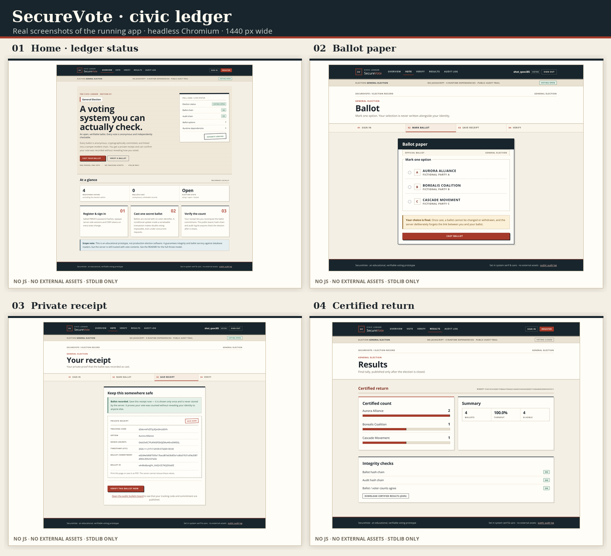
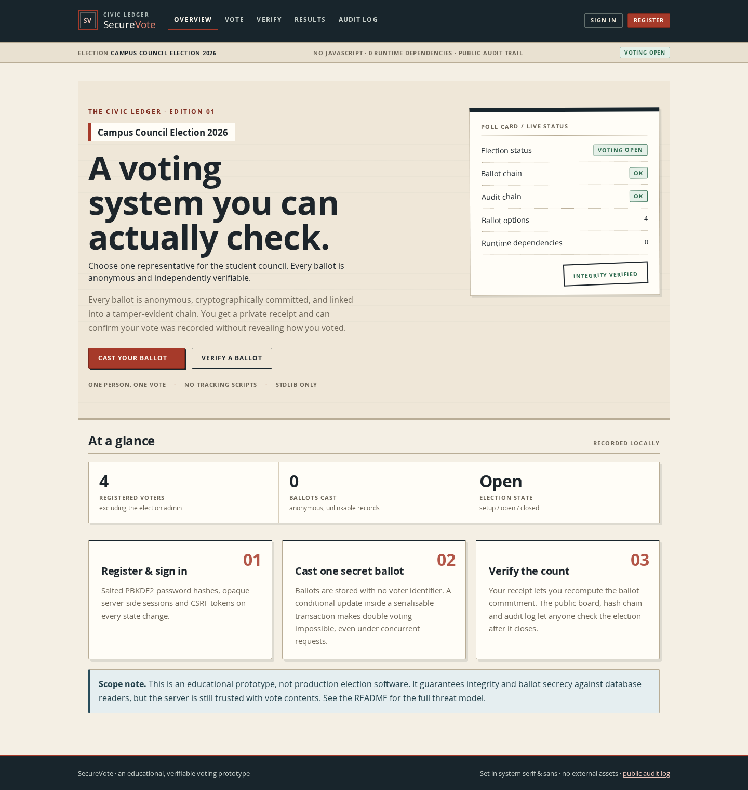

# Secure-Voting-System


A working, **verifiable** electronic voting prototype. Every ballot is
anonymous, cryptographically committed, and linked into a tamper-evident chain;
voters get a private receipt that proves their vote was recorded without
revealing how they voted. Elections are configurable, voter rolls can be
imported atomically, and certified results / audit trails export as JSON for
offline verification.

Built with the **Python standard library only** — no runtime dependencies, no
build step, no external fonts/assets, no JavaScript. For a system that makes
security claims, a small, readable trusted computing base is a feature; the
civic-paper ledger UI is designed to look deliberate rather than generated.

> ⚠️ **This is an educational prototype, not software for real elections.**
> It provides integrity and ballot secrecy against database readers, but the
> server is still trusted with vote contents. Read
> [Threat model & limitations](#threat-model--limitations) before using it for
> anything serious.

---

## What changed

The repository previously contained one line (`# Secure-Voting-System`). It now
contains a complete, tested application:

| Before | After |
| --- | --- |
| A title | Runnable web app with a live UI (register → vote → receipt → verify → results) |
| No code | ~3,300 lines of documented Python across 10 focused modules |
| One hard-coded ballot | Strict `SVS_ELECTION_FILE` definitions with immutable candidate fingerprints |
| No data portability | Atomic CSV voter import; signed results bundles and full audit trails as JSON downloads / CLI exports |
| No guarantees | Ballot secrecy by schema, one-person-one-vote by transaction, hash-chained ballots + audit log, end-to-end receipt verification, signed external checkpoints |
| No tests | 105 unit + HTTP integration tests, all passing in ~2 s; **96% statement coverage** |
| No CI | GitHub Actions matrix on Python 3.10–3.13 with a `coverage report --fail-under=90` gate, HTTP lifecycle smoke, CLI/import/export smoke, and a **real Chromium E2E job** |
| Generic gradient UI | A civic-paper ledger: warm paper, ink rules, vermilion stamp, serif display type, ballot sheets, printable receipts, progress stepper and ledger tables |
| No accessibility | Skip link, labelled controls, unique ids, `aria-current`, `aria-label` on result bars, focus-visible rings, reduced-motion support, CSP with no JS |
| No docs beyond the title | README, screenshots, `docs/DESIGN.md`, `docs/EXTENDING.md`, MIT license, Makefile, CI, issue/PR templates, contributing, security and conduct policies |

---

## Quick start

Requires Python 3.10+. No `pip install` needed.

```bash
python3 -m secure_vote demo
# open http://localhost:8000
```

Or, with a fresh election and a randomly generated admin password:

```bash
python3 -m secure_vote init          # prints the admin password ONCE
python3 -m secure_vote add-voter alice
python3 -m secure_vote serve
```

Use the bundled four-option election and voter roll:

```bash
export SVS_ELECTION_FILE=examples/election.json
export SVS_DB=data/campus-election.db
python3 -m secure_vote init                 # prints the admin password ONCE
python3 -m secure_vote import-voters examples/voters.csv
python3 -m secure_vote serve
```



A custom election file renders its own title, description and options:



More full-size captures are in [`screenshots/`](screenshots/).

### Demo accounts

| Role | Username | Password |
| --- | --- | --- |
| Admin | `admin` | `AdminPass123!` |
| Voter | `alice`, `bob`, `carol`, `diana` | `DemoPass123!` |

Demo credentials are only seeded by the `demo` command and are displayed on the
sign-in page. Never use demo mode in a real deployment.

---

## Walkthrough

1. **Register** (or sign in with a demo account). Passwords are PBKDF2-HMAC-SHA256
   with a per-user salt; sessions are opaque random tokens stored only as hashes.
2. **Cast one ballot.** The ballot form lists the candidates; a conditional
   `UPDATE ... WHERE has_voted = 0` inside a `BEGIN IMMEDIATE` transaction makes
   double voting impossible even under concurrent requests.
3. **Save the receipt.** It contains a tracking code, a secret nonce, the
   timestamp, and the ballot's SHA-256 commitment. It is shown exactly once and
   is deliberately never stored: keeping it next to the voter would recreate the
   voter↔ballot link the design removes.
4. **Verify.** Anyone can look up a tracking code on the public bulletin board.
   Only the receipt holder can recompute the commitment and confirm the ballot
   was *recorded as cast*.
5. **Close and count.** An admin closes the election (`/admin`), which seals and
   publishes the tally together with integrity checks and a reproducible results
   digest. Closing is irreversible.

---

## Design & UX

The interface is deliberately **not** a generic SaaS dashboard. It uses a
civic-paper ledger system: warm paper, ink rules, one vermilion stamp accent,
editorial serif headings, tabular records, ruled ballot sheets and a receipt
that prints cleanly. There are no external fonts, icon packs, images, JS or
inline styles — the whole visual identity is one local stylesheet.

UX decisions are functional, not decorative:

* A persistent **status strip** shows the active election and whether voting is
  open on every page.
* A four-step **progress ledger** (sign in → ballot → receipt → verify) keeps
  voters oriented through the whole flow.
* Ballot options are lettered paper rows with generous hit areas; the warning
  is next to the irreversible action.
* The one-time receipt is framed as a physical document with a print hint and a
  `@media print` layout.
* Sealed results use an envelope state instead of an empty chart, and published
  results read like a certified return with digest and download links.
* Audit and bulletin-board data use ruled ledger tables with tabular numerals.

See [`docs/DESIGN.md`](docs/DESIGN.md) for the visual rules, tokens and
anti-patterns; contributions should preserve them.

---

## Custom elections, import & export

Point `SVS_ELECTION_FILE` at a strict JSON definition **before the first
`init`**:

```json
{
  "title": "Campus Council Election 2026",
  "description": "Choose one representative for the student council.",
  "candidates": [
    {"key": "atlas", "label": "Atlas Ticket", "description": "Longer library hours"},
    {"key": "beacon", "label": "Beacon List", "description": "Club funding"}
  ]
}
```

Validation requires 2–20 candidates, unique lowercase `a-z0-9_` keys, labels,
and bounded free text. The title, description and candidates are persisted in
the database; a keyed fingerprint of the ballot definition is checked on every
startup. Starting an existing DB with a different candidate list raises a clear
error instead of silently invalidating already-cast ballots. Use a fresh
`--db` path or `reset --yes` for a new election.

Bulk voter rolls are CSV, with an optional `username,password` header:

```bash
python3 -m secure_vote import-voters examples/voters.csv
```

The entire file is validated and inserted inside one `BEGIN IMMEDIATE`
transaction: one duplicate or weak password rolls back **all** rows. Passwords
never enter the audit log.

Once the election is closed, results and the full audit chain are available as
machine-readable JSON:

```bash
python3 -m secure_vote export --what results --output results.json
python3 -m secure_vote export --what audit --output audit.json
```

The same bundles are downloadable from `/export/results.json` and
`/export/audit.json`, with links on the results and audit pages. While voting is
open, the results endpoint returns `409` with a sealed-election error; the audit
trail is public throughout. The results bundle includes the election definition,
certified count, integrity summary and a signed chain-head checkpoint. The audit
bundle includes every `prev_hash` / `entry_hash` value for offline recomputation.

---

## Security properties

| Property | Mechanism | Covered by tests |
| --- | --- | --- |
| Credential safety | PBKDF2-HMAC-SHA256 (260k iterations, 16-byte salt, cost stored with hash), constant-time compare, dummy hash for unknown usernames | `test_crypto.py`, `test_password_is_not_stored_in_plaintext` |
| Session safety | 256-bit opaque tokens, SHA-256 hashed at rest, server-side expiry, rotation on login (anti-fixation), `HttpOnly` + `SameSite=Strict` cookies | `test_session_*`, `test_login_sets_hardened_cookie_and_hashed_session` |
| Ballot secrecy | `ballots` table has **no voter column and no foreign key**; receipts are never persisted; audit log never contains choices or nonce values; bulletin board is sorted by tracking code, not insertion order | `test_ballots_table_has_no_voter_reference`, `test_receipt_secrets_never_appear_in_audit_log_or_sessions`, `test_bulletin_board_is_sorted_by_tracking_code` |
| One person, one vote | Conditional update inside a serialisable write transaction; 6 concurrent threads produce exactly 1 ballot | `test_concurrent_votes_are_serialised` |
| Recorded-as-cast | `ballot_hash = SHA256(tag ‖ tracking_code ‖ choice ‖ nonce ‖ timestamp)`; the secret nonce prevents outsiders brute-forcing a choice from the public hash | `test_receipt_commitment_is_recomputable_by_the_voter`, `test_verify_receipt_positive_and_negative` |
| Tamper evidence | Keyed HMAC chain over all ballots + a second HMAC chain over the audit log; any edit, deletion or reordering is detected | `test_ballot_chain_detects_*`, `test_audit_chain_detects_tampering` |
| External anchoring | `checkpoint` exports an HMAC-signed snapshot of both chain heads; `verify --checkpoint` proves the file was not edited and that its chain prefix still exists | `test_checkpoint.py`, `test_checkpoint_export_and_verification` |
| Immutable ballot definition | Strict election-file validation; DB-stored title/description/candidates and a keyed candidate fingerprint checked on every startup | `test_election_file_*`, `test_candidate_definition_is_immutable_after_init` |
| Atomic voter roll import | All rows validated and inserted in one transaction; duplicate or weak credential rolls back the entire file | `test_import_voters_is_atomic`, `test_import_voters_csv` |
| Portable verification | Results bundle carries tally + integrity + signed checkpoint; audit bundle carries full HMAC chain; results remain sealed until close | `test_export_*`, `browser_e2e.py` |
| Sealed results | Tally refuses to run until the election is `closed`; transitions are monotonic (`setup → open → closed`) | `test_results_are_sealed_until_close`, `test_state_transitions_are_monotonic` |
| Web hardening | CSRF token on **every** POST, HTTP method checks, body-size/content-type/UTF-8 validation, HTML escaping by construction, strict CSP (no scripts, no inline styles), `nosniff`, `no-store`, login rate limiting | `test_csrf_is_required_on_every_post`, `test_bad_content_type_and_oversized_body`, `test_candidate_labels_are_html_escaped`, `test_login_rate_limiting` |

---

## How verification works

```
receipt (voter only)          bulletin board (public)
─────────────────────         ─────────────────────────
tracking_code  ──────────────▶ tracking_code
choice                        ballot_hash
nonce (secret)                chain status
created_at
ballot_hash

voter recomputes:
  SHA256("securevote/v1/ballot" ‖ tracking_code ‖ choice ‖ nonce ‖ created_at)
  == published ballot_hash   →  ballot recorded as cast
```

All hash inputs are **length-prefixed** and **domain-separated** (see
`crypto.py`), so ambiguous concatenations and cross-purpose replays cannot
occur. Each ballot also carries `chain_hash = HMAC(server_key, prev_chain_hash ‖
ballot_id ‖ tracking_code ‖ ballot_hash)`; recomputing the whole chain detects
edits, deletions and reordering.

An outsider seeing only `tracking_code` and `ballot_hash` cannot recover the
choice: the 192-bit secret nonce is on the receipt, not on the board.

---

## Integrity checkpoints

Because the application host also serves the bulletin board, an observer needs
evidence stored *off-host*. A checkpoint is a small signed JSON snapshot of both
chain heads, the election state, and (once closed) the results digest:

```bash
python3 -m secure_vote checkpoint --output /safe/place/checkpoint.json
# ...later, or from an independent machine...
python3 -m secure_vote verify --checkpoint /safe/place/checkpoint.json
```

`verify --checkpoint` checks the HMAC signature (so the saved file was not
edited), recomputes both chains, confirms the checkpointed head still exists at
its recorded sequence number, and compares the published results digest. Keep
the file somewhere the election server cannot rewrite. This is a **detective**
control, not a distributed transparency log — see
[`docs/EXTENDING.md`](docs/EXTENDING.md) for the full production design.

---

## Architecture

```
secure_vote/
├── config.py     Environment-driven, immutable Config + strict election files
├── crypto.py     PBKDF2, HMAC, SHA-256 commitments, CSPRNG tokens
├── db.py         SQLite schema, PRAGMAs, BEGIN IMMEDIATE transactions
├── audit.py      Append-only HMAC-chained event log
├── service.py    Election domain logic — the ONLY place ballots are created
├── views.py      Escaped HTML rendering (no JS anywhere)
├── app.py        http.server routing, sessions, CSRF, rate limit, headers
├── demo.py       Idempotent demo seeding
├── __main__.py   CLI (init / serve / demo / add-voter / import-voters / state /
│                 tally / verify / checkpoint / export / reset)
└── static/       One stylesheet
tests/            105 tests: crypto, config, CLI, domain, checkpoints, HTTP, exports, design
scripts/e2e.py          Dependency-free HTTP lifecycle used by CI
scripts/browser_e2e.py  Real Chromium UI, CSS + download lifecycle used by CI
examples/               Sample election definition and voter CSV
docs/DESIGN.md          Civic-ledger visual system and UX rationale
docs/EXTENDING.md       Production-grade upgrade path
.github/                CI, issue / PR templates, community policies
screenshots/            Real UI captures (headless Chromium)
```

Data flow:

```
browser ──POST──▶ app.py ──▶ service.cast_ballot ──┬──▶ voters   (has_voted = 1)
                     │                              ├──▶ ballots  (no voter id)
                     │                              └──▶ audit_log (HMAC chain)
                     └──▶ receipt returned ONCE, never stored
```

Design rules worth noting:

* **One connection per request.** SQLite objects are not shared across threads;
  `ThreadingHTTPServer` handles concurrency.
* **No framework magic.** All session, cookie, CSRF and header handling is in one
  readable file.
* **`open_db()` closes connections.** `sqlite3.Connection.__exit__` commits but
  does *not* close, so a context manager wraps it.
* **`script-src 'none'`.** There is no JavaScript; result bars use native
  `<progress>` so the CSP needs no `unsafe-inline` escape hatch.

---

## Threat model & limitations

**Assumed:** an honest server during the election; HTTPS terminated by a reverse
proxy; a trusted admin for opening/closing; a secret HMAC key held by the server.

**Not provided — do not deploy this for a real election:**

1. **No end-to-end encryption / no ballot privacy against the server.** The
   server sees the plaintext choice when the ballot is submitted. Real systems
   use threshold/homomorphic encryption with distributed trustees so no single
   party can decrypt.
2. **No coercion resistance or receipt-freeness.** A voter can show their nonce
   and prove how they voted. Real elections need mechanisms (re-voting, fake
   credentials, or cryptographic receipt-freeness) to make vote-selling
   impossible.
3. **No cryptographic eligibility proofs.** Voter lists and `has_voted` are
   trusted database state; there is no anonymous credential or blind signature
   scheme.
4. **Timing / metadata correlation.** A database reader who also observes login
   times may correlate a voter with a nearby ballot. The bulletin board is
   shuffled by tracking code, but `created_at` is still stored. Batch release or
   mixnets would be required.
5. **Single trusted key.** The HMAC key lives in a `0600` file next to the DB by
   default for local reproducibility. Anyone with both can rewrite the chains.
   Use `SVS_SECRET_KEY` from a KMS/HSM, stored separately. The `checkpoint`
   command now lets an external witness anchor both chain heads off-host (see
   [Integrity checkpoints](#integrity-checkpoints)), but that is a detective
   control, not a prevention control.
6. **Plain HTTP by default.** Cookies omit `Secure` unless
   `SVS_SECURE_COOKIES=1`, and framing protections are opt-in
   (`SVS_STRICT_FRAME_POLICY=1`) because the hosted preview is embedded in an
   iframe. When that preview is cross-site, `SVS_SAMESITE=none` is needed for
   cookies to be sent at all (it weakens the SameSite CSRF defence, but every
   POST is protected by a synchronizer token instead). A real deployment must
   terminate TLS, use `SVS_SAMESITE=strict` and enable both flags.
7. **In-process rate limiting.** `RateLimiter` is per-process memory; multiple
   workers need a shared store.
8. **No distributed verifiability.** The bulletin board is served by the same
   server that holds the data; independent mirrors/witnesses with Merkle
   consistency proofs would be needed.
9. **No professional accessibility audit, i18n, load testing, backups, or
   operational procedures.** Keyboard/semantics basics are covered (skip link,
   labelled controls, focus rings, ARIA), but there is no WCAG sign-off.
   SQLite WAL is used, but replication and disaster recovery are out of scope.

---

## HTTP endpoints

| Method | Path | Purpose | Auth |
| --- | --- | --- | --- |
| GET | `/` | Overview, statistics, live integrity status | public |
| GET/POST | `/login`, `/register` | Sign in / create a voter account | public |
| POST | `/logout` | Revoke session | session + CSRF |
| GET/POST | `/vote` | Ballot form / cast ballot | session + CSRF |
| GET/POST | `/verify` | Public bulletin board; look up a code or verify a full receipt | public (CSRF on POST) |
| GET | `/results` | Sealed notice, or certified tally after close | public |
| GET | `/audit` | Public, hash-chained event log | public |
| GET | `/admin` | State controls, statistics, integrity status | admin |
| POST | `/admin/transition` | `open` → `closed` (irreversible) | admin + CSRF |
| GET | `/export/results.json` | Certified results bundle (409 while voting is open) | public |
| GET | `/export/audit.json` | Full hash-chained audit trail as JSON | public |
| GET | `/static/style.css`, `/healthz` | Assets / health probe | public |

Every POST requires a CSRF token. Anonymous forms use a double-submit cookie;
authenticated forms use the session-bound synchronizer token.

---

## CLI

```bash
python3 -m secure_vote init [--admin-user admin] [--admin-password ...]
python3 -m secure_vote serve
python3 -m secure_vote demo [--reset]
python3 -m secure_vote add-voter alice [--password ...]
python3 -m secure_vote import-voters examples/voters.csv
python3 -m secure_vote state [open|closed]
python3 -m secure_vote tally
python3 -m secure_vote verify        # exit 1 if either chain is broken
python3 -m secure_vote verify --checkpoint /safe/place/checkpoint.json
python3 -m secure_vote checkpoint [--output PATH]  # signed chain-head snapshot
python3 -m secure_vote export --what results [--output PATH]
python3 -m secure_vote export --what audit [--output PATH]
python3 -m secure_vote reset --yes
```

All commands accept `--db PATH`, `--host HOST`, `--port PORT`, before or after
the subcommand.

---

## Configuration

| Variable | Default | Meaning |
| --- | --- | --- |
| `SVS_DB` | `data/election.db` | SQLite database path |
| `SVS_KEY_FILE` | `<db dir>/server.key` | HMAC key file (created `0600`) |
| `SVS_SECRET_KEY` | — | Hex key from a KMS; overrides the key file |
| `SVS_ELECTION_FILE` | — | Strict JSON election definition; set before the first `init` (see [`examples/election.json`](examples/election.json)) |
| `SVS_PBKDF2_ITERATIONS` | `260000` | Password hash cost |
| `SVS_SESSION_TTL` | `1800` | Session lifetime (seconds) |
| `SVS_MAX_BODY_BYTES` | `16384` | Max POST body size |
| `SVS_LOGIN_MAX_FAILURES` / `SVS_LOGIN_WINDOW` | `5` / `300` | Failed-login lockout |
| `SVS_SECURE_COOKIES` | `0` | Add the `Secure` cookie flag |
| `SVS_SAMESITE` | `strict` | `strict` / `lax` / `none`. Use `none` for an HTTPS **iframe** preview (adds `Secure` + `Partitioned`); keep `strict` on plain `http://localhost` where `Secure` cookies are rejected |
| `SVS_STRICT_FRAME_POLICY` | `0` | Add `X-Frame-Options: DENY` + CSP `frame-ancestors 'none'` |
| `SVS_DEMO` | `0` | Show demo credentials on the sign-in page |
| `SVS_HOST` / `PORT` (or `SVS_PORT`) | `0.0.0.0` / `8000` | Bind address |

Runtime state (`data/`, `*.db`, `*.key`) is gitignored.

---

## Testing

```bash
python3 -m unittest discover -s tests -v       # 105 tests, ~2 s, no deps
python3 scripts/e2e.py                         # full lifecycle over real sockets
make check                                     # tests + 90% coverage gate + e2e
```

The suite covers cryptographic primitives, configuration and CLI commands,
custom election files and immutability, atomic CSV imports, JSON exports,
election invariants (including a 6-thread concurrent voting test), signed
checkpoints, hash-chain tampering, and a real HTTP server exercised over sockets
(cookies, CSRF, rate limiting, admin transitions, HTML escaping, security
headers, accessibility markers). It needs no network and no third-party
packages. For coverage:

```bash
python3 -m pip install -r requirements-dev.txt   # coverage only; dev/CI use
coverage run --source=secure_vote -m unittest discover -s tests
coverage report --fail-under=90
```

### Real-browser E2E

CI also installs Playwright's Chromium and renders the app — no JS, but real
CSS, serif type, ledger rules, forms, cookies, CSRF tokens, downloads and redirects:

```bash
make browser-install                 # installs requirements-browser.txt + Chromium
make check-all                       # coverage + HTTP E2E + Chromium E2E
```

Set `SVS_CHROME_PATH` to use an existing Chromium binary instead of the
Playwright-managed download. The browser test uses
[`examples/election.json`](examples/election.json), casts a ballot, verifies its
one-time receipt, checks the public board, confirms results are sealed, closes
as admin through the UI, and validates both JSON downloads.

Current result: **105 tests, 96% statement coverage**; core modules are 92–100%.
CI (`.github/workflows/ci.yml`) enforces the gate on Python 3.10–3.13, runs
`scripts/e2e.py` plus a CLI/import/export smoke test, and runs a separate
`Real Chromium E2E` job on Python 3.12.

---

## Deployment checklist (if you extend this)

- [ ] Terminate TLS; set `SVS_SECURE_COOKIES=1`, `SVS_SAMESITE=strict` and `SVS_STRICT_FRAME_POLICY=1`
- [ ] Move the HMAC key to a KMS/HSM; export `checkpoint` snapshots to an off-host witness
- [ ] Replace plaintext ballots with threshold encryption + distributed trustees
- [ ] Add coercion resistance / receipt-freeness and independent bulletin-board witnesses
- [ ] Replace the in-memory rate limiter with a shared store
- [ ] Commission a professional WCAG / security audit; add load and disaster-recovery tests (browser E2E and a 90% coverage gate are already in CI)

See [`docs/EXTENDING.md`](docs/EXTENDING.md) for the detailed, ordered upgrade path.

## Contributing & repository policies

- [`docs/DESIGN.md`](docs/DESIGN.md) — visual system, UX rationale and anti-patterns
- [`CONTRIBUTING.md`](CONTRIBUTING.md) — local setup, test gates and PR expectations
- [`SECURITY.md`](SECURITY.md) — how to report a vulnerability (please do not open a public issue)
- [`CODE_OF_CONDUCT.md`](CODE_OF_CONDUCT.md) — community standards
- [`CHANGELOG.md`](CHANGELOG.md) — release notes
- [`.github/ISSUE_TEMPLATE/`](.github/ISSUE_TEMPLATE/) and [`.github/pull_request_template.md`](.github/pull_request_template.md) — structured reports and review checklists

## License

MIT — see [LICENSE](LICENSE).
